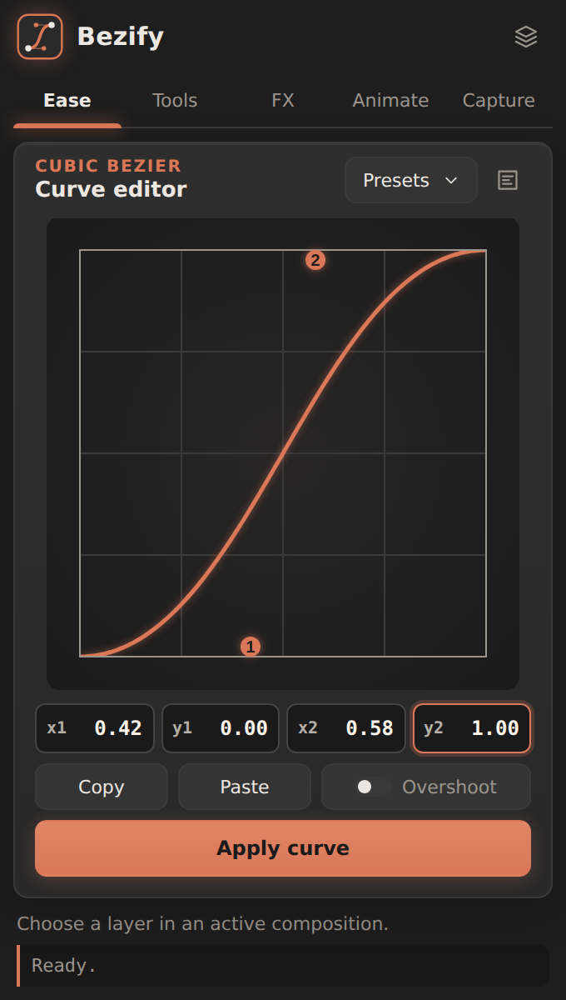
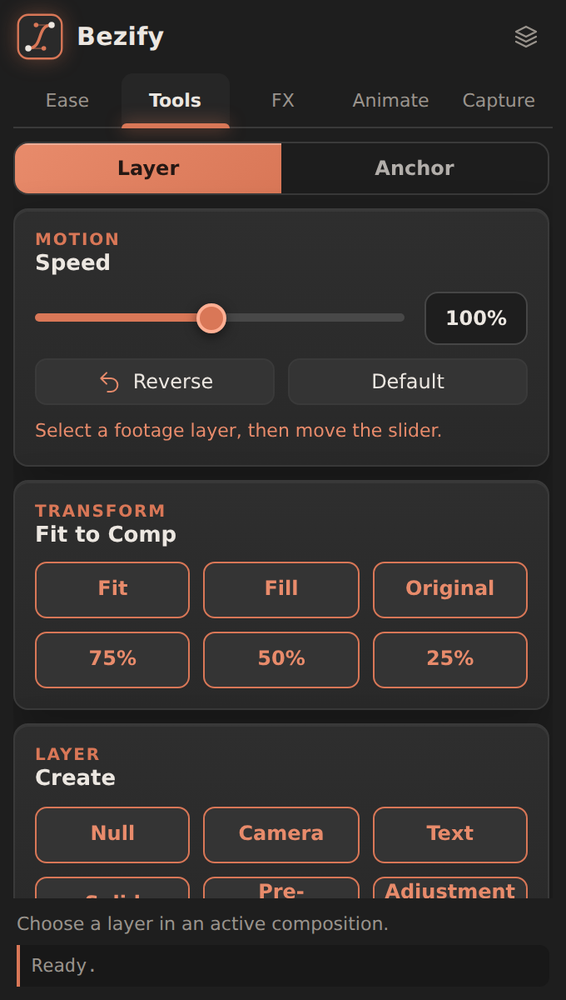
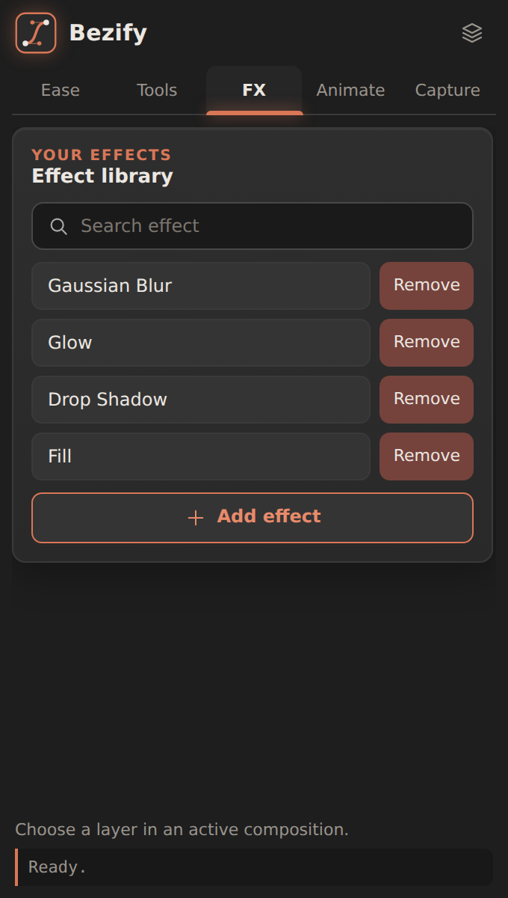

# Bezify

**Ease curves, one-click layer tools and your own effect library for After Effects.**

Bezify is a free, open source After Effects panel. Version 1.0.0 is released under the GPL-3.0 license. Future versions may be paid.

| Ease | Tools | FX |
|---|---|---|
|  |  |  |

*Screenshots are UI previews of the panel.*

## Features

**Ease**
- Square cubic-bezier editor with draggable handles (handles stay inside the square)
- Apply the curve to selected keyframes
- Built-in presets plus your own saved curves, with a small preview for each
- Copy / Paste curve values, optional Overshoot mode

**Tools**
- *Layer:* **Speed** slider (10% to 200%) with a Reverse toggle, **Fit to Comp** (Fit, Fill, Original, 75%, 50%, 25%), and **Create** buttons (Null, Camera, Text, Solid, Pre-compose, Adjustment Layer). New layers match the length of the selected layer.
- *Anchor:* 3x3 one-click anchor point. The layer stays where it is.

**FX**
- Build your own list of effects (works with any effect or plugin installed in your After Effects), search it, and add an effect to the selected layers with one click.

**Animate**
- Quick presets (slide, pop, fade, bounce) and stagger for multiple layers.

**Capture**
- Save a layer's transform animation and re-apply it to other layers.

## Requirements

- After Effects 2019 (16.0) or later
- Windows or macOS
- Developed and tested on **Windows**. The macOS installer is included but has **not been tested on a Mac yet**. Please report problems.

## Install

Bezify is a CEP panel and it is **not signed** with an Adobe certificate, so the installer turns on Adobe's `PlayerDebugMode` setting so that After Effects will load it. Nothing else on your system is changed.

Always **close After Effects first**, and **extract the zip** before running anything (do not run the files from inside the zip).

### Windows
1. Download `Bezify-1.0.0.zip` from the [Releases](../../releases) page.
2. Right-click the zip, open **Properties**, tick **Unblock** (if shown), click OK. This reduces warnings.
3. Right-click the zip and choose **Extract All**.
4. Double-click **`install.bat`**.
   - If Windows shows "Windows protected your PC", click **More info**, then **Run anyway**. The script is plain text, you can read it first.
   - Do not double-click `install.ps1` directly; Windows opens it in Notepad instead of running it.
5. When you see "Bezify installed successfully", start After Effects and open **Window > Extensions (Legacy) > Bezify**.

Prefer a command? Open PowerShell in the extracted folder and run:

```
powershell -ExecutionPolicy Bypass -File .\install.ps1
```

### macOS
1. Download and extract `Bezify-1.0.0.zip`.
2. Open **Terminal**, type `bash ` (with a space), drag `install.command` into the window, and press Enter.
   - Double-clicking `install.command` may be blocked by Gatekeeper. If so, right-click it, choose **Open**, then **Open** again.
   - If macOS still complains about the downloaded files, run: `xattr -dr com.apple.quarantine ~/Downloads/Bezify-1.0.0` (adjust the folder path).
3. Start After Effects and open **Window > Extensions (Legacy) > Bezify**.

### Manual install (any system)
1. Turn on PlayerDebugMode for CEP 9 to 13.
   - Windows: in the registry, under `HKEY_CURRENT_USER\Software\Adobe\CSXS.<version>`, add a **string** value named `PlayerDebugMode` with the value `1`.
   - macOS: run `defaults write com.adobe.CSXS.<version> PlayerDebugMode 1` in Terminal.
2. Copy the `Bezify` folder into:
   - Windows: `%APPDATA%\Adobe\CEP\extensions`
   - macOS: `~/Library/Application Support/Adobe/CEP/extensions`
3. Restart After Effects.

### Update
Run the installer again. Your saved curves, capture presets and FX list are kept.

### Uninstall
Close After Effects and run `uninstall.bat` (Windows) or `uninstall.command` (macOS). Your saved presets are copied to your Desktop first. PlayerDebugMode is left on because other panels may need it.

## Good to know

- **Speed** works on footage and pre-comp layers. Reverse uses a negative time stretch and keeps the layer in place.
- **Fit / Fill** skip parented layers, 3D layers and layers with an expression on scale or position. **Anchor** skips layers with animated anchor, scale or rotation.
- **FX > Add effect:** apply the effect to a layer once, select that effect (click its name in Effect Controls or the timeline), then press **Add effect**.
- Everything is stored locally in the `presets` folder inside the panel. Bezify does not use the network and sends no data anywhere.
- Some features have had limited testing across layer types and After Effects versions. If something looks wrong, please open an issue with your After Effects version and what you selected.

## Repository layout

```
Bezify/              the panel (CEP): index.html, css, js, jsx (ExtendScript), icons
install.bat / .ps1   Windows installer
install.command      macOS installer
uninstall.*          uninstallers
tools/               developer helper (icon generator)
docs/screenshots/    images used in this README
```

## License

Copyright (C) 2026 Bezify

This program is free software: you can redistribute it and/or modify it under the terms of the GNU General Public License version 3 as published by the Free Software Foundation. It is distributed without any warranty. See the [LICENSE](LICENSE) file.

The **Bezify** name and logo are not licensed for use by forks or derived products. If you publish a modified version, please give it a different name.

## Contributing

Bug reports and ideas are welcome in Issues. See [CONTRIBUTING.md](CONTRIBUTING.md).
